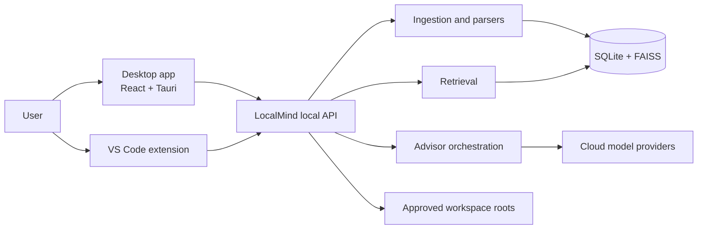

# LocalMind v2 Architecture

Status: foundation draft for Milestone 0. Owner review is required before the
decisions marked **provisional** are treated as final.

## 1. Purpose

LocalMind v2 is a local-first document and code intelligence product with two
client surfaces:

1. The existing React + Tauri desktop application.
2. A VS Code extension.

The product must provide trustworthy PDF/document intelligence first, then a
coding-oriented engineering advisor. The first shipped advisor is read-only: it
may retrieve approved context, search, explain, review, and propose changes, but
it may not edit files, execute commands, or mutate Git.

The initial hardware target is 8 GB RAM. Local embeddings and SQLite/FAISS stay
the default storage and retrieval foundation. Large mandatory local language
models and heavyweight infrastructure are out of scope.

## 2. Confirmed decisions

These decisions are the baseline for implementation:

- **One authoritative backend.** `backend/server.py` is the active API. The
  older `backend/main.py` + `backend/app` tree is legacy and receives no new
  features. See `docs/adr/0001-authoritative-backend.md`.
- **Two clients, one API.** The desktop app and the VS Code extension use the
  same versioned local API. Retrieval and advisor logic live in the backend, not
  in either client. See `docs/adr/0005-desktop-and-vscode-clients.md`.
- **Advisor-only first release.** No in-product tool may write files, run shell
  commands, commit code, or mutate Git. See
  `docs/adr/0003-advisor-only-tools.md`.
- **Explicit workspace trust.** File access is limited to roots the user has
  approved. Permissions are enforced in code, not only in prompts. See
  `docs/adr/0004-workspace-trust-and-privacy.md`.
- **Grounded answers.** Document-grounded answers must carry real citations to
  the retrieved document, page, and chunk. If evidence is insufficient, the
  answer must say so.
- **Citations and provenance are data, not prose.** Document IDs, page numbers,
  chunk IDs, content hashes, extraction method, and parser version belong in the
  retrieval/storage model.
- **Deterministic checks are separate from AI review.** Explicit architecture
  rules fail checks deterministically. Subjective AI findings are labeled
  review suggestions.
- **Local-first by default.** Local storage and local embeddings remain the
  foundation. Cloud reasoning is opt-in and sends the minimum necessary context.

## 3. Provisional decisions and open questions

### Provisional

- **Cloud reasoning with BYOK.** The design assumes the user supplies a model
  provider key and LocalMind does not operate a model service by default. This
  is a starting assumption, not a permanent product decision. See
  `docs/adr/0002-cloud-byok-provider-strategy.md`.
- **VS Code before other IDEs.** VS Code is the first extension target.
- **Python and TypeScript/JavaScript first.** These are the first language
  intelligence targets.

### Open

- Whether LocalMind will also offer a hosted service, and under what data terms.
- Which cloud provider(s) to support first.
- OCR stack and renderer: Tesseract plus which PDF renderer.
- Whether to use `pdfplumber` for table/layout extraction and on which fixtures.
- Desktop packaging, code signing, update strategy, and supported platforms.
- Local API authentication mechanism for the desktop/extension clients.
- Telemetry policy and crash reporting (default: none).
- Which architecture policy files and rule format become authoritative.

## 4. System context



The local API is the trust boundary. Clients are presentation surfaces. Cloud
providers see only the context explicitly selected by the advisor and allowed by
the user's privacy settings.

## 5. Target component boundaries

### API

- Request/response validation and versioned contracts.
- Authentication/authorization for local clients.
- Job, session, workspace, search, document, and proposal endpoints.
- Thin handlers; business logic belongs in services.

### Domain

Typed models for:

- documents, pages, chunks, citations;
- indexing jobs and their states;
- workspaces and approved roots;
- retrieval evidence;
- proposed changes, risks, and policy findings;
- advisor sessions and events.

Domain code must not depend on UI code or concrete cloud SDKs.

### Ingestion

- Parser registry with one interface for all document types.
- PDF/text/code parsers, with an optional OCR adapter.
- Normalization, page-aware chunking, fingerprints, indexing, and cleanup.
- Parser errors are reported as job/document status, not swallowed.

### Retrieval

- Semantic FAISS search plus SQLite FTS5/lexical search and filename/path
  matching.
- Ranking and structured evidence.
- Citation generation from chunk provenance.
- Measure quality before adding rerankers.

### Agent / advisor

A bounded workflow:

1. Classify the request.
2. Retrieve approved context.
3. Load applicable project policies.
4. Produce a plan or answer.
5. Validate evidence and cite sources.
6. Report limitations, uncertainty, and policy findings.

The advisor uses a typed, read-only tool registry. It cannot grant itself
permissions.

### Providers

- Typed provider interface with timeouts, token limits, normalized errors, and
  streaming.
- Provider-specific code does not leak into domain services.
- BYOK credentials live in the OS credential store, never in logs, URLs,
  ordinary database fields, or frontend persistent state.

### Architecture guard

- Deterministic checks for dependency/import boundaries, migrations, and quality
  gates.
- Versioned project rules from files such as `ARCHITECTURE.md`,
  `architecture/policy.yaml`, ADRs, and `AGENTS.md`.
- AI review findings are suggestions with file/rule citations, not blockers.

### Storage

- Existing SQLite/SQLAlchemy and FAISS foundation.
- Alembic migrations for schema changes.
- Stable document/chunk IDs and consistent lifecycle operations.
- Approved workspace roots and file access limits.

### Clients

- Desktop and VS Code use the same local API contracts.
- Clients render results, citations, plans, findings, and proposed diffs.
- Clients do not reimplement retrieval, ranking, citations, or advisor policy.

## 6. Current-to-target mapping

| Area | Current state | v2 target |
| --- | --- | --- |
| Active API | `backend/server.py`, port 8001 | Same API, versioned contracts |
| Legacy API | `backend/main.py` + `backend/app`, port 8000 | Frozen, isolated, imports migrated incrementally |
| Metadata | SQLAlchemy `files` table, `create_all` | Alembic-managed schema with document/page/chunk models |
| Vectors | FAISS + pickle of `path`/`text` | Stable IDs and provenance; replace/delete by document |
| Keyword | In-memory FTS5 over chunk text | Shared retrieval layer with structured evidence |
| Documents | Text/code, plus local PDF/DOCX/ODT extraction | Parser registry, page-aware PDFs, OCR adapter, job status |
| Ask | Raw question to Ollama client, empty sources | Retrieval-grounded answer with citations |
| Clients | Desktop search UI | Desktop document chat/library + VS Code extension |
| Quality | Ad-hoc scripts, no CI | pytest, API tests, ruff, TypeScript build, GitHub Actions |
| Access | Arbitrary indexing paths | Approved workspace roots, central ignore and limits |

## 7. Data and index lifecycle

Planned invariants:

- Every document has a stable document ID and a content fingerprint.
- Every chunk has a stable chunk ID and a parent document ID.
- A changed file replaces all of its old chunks; it does not append a second
  generation.
- A deleted or moved file removes or reassigns its chunks.
- Retrying an indexing job does not duplicate vectors or metadata.
- Chunk metadata retains path, document ID, page number, chunk ID, extraction
  method/status, parser version, and content hash where practical.
- The citation model points to a real chunk and page, not only a filename.

The current active index is append-only and does not yet satisfy these
invariants. This is tracked as LM-005 and must be fixed before grounded citations
are treated as reliable.

## 8. Security and privacy invariants

- The local API binds to loopback by default.
- Production CORS is an explicit allowlist, not `*`.
- Local client authentication is required before public beta.
- File access is restricted to explicitly approved workspace roots.
- Normalize paths and block traversal and symlink escapes.
- Reuse a central ignore policy and enforce file/page/size/resource limits.
- Treat documents, source files, READMEs, and repository instructions as
  untrusted content.
- Prompt text cannot override tool permissions.
- Never log raw document content or secrets by default.
- Send only the minimum context needed to the selected cloud provider.
- Do not upload whole repositories or entire PDFs by default.
- Sensitive files/folders can be excluded from cloud context.
- Deterministic policy violations fail; AI review findings are labeled
  separately.

## 9. Quality gates

A clean checkout must be able to run:

```powershell
py -m pip install -r backend/requirements-dev.txt
py -m ruff check backend tests
py -m pytest
cd desktop
npm ci
npm run build
```

CI must not download an embedding model or call a cloud provider. Tests use
temporary databases, fake embeddings, and local fixtures.

Database schema changes require migrations. Index mutations require consistency
tests. Document-grounded answers require citation tests.

## 10. Milestone mapping

| Milestone | Architecture touchpoints |
| --- | --- |
| 0 Foundation | ADRs, CI, authoritative backend, migrations, index consistency, workspace boundaries |
| 1 PDF/document ingestion | Parser registry, page provenance, OCR adapter, job states, document library |
| 2 Grounded Q&A | Hybrid retrieval, citations, provider interface, BYOK storage, document chat |
| 3 Engineering advisor | Read-only tools, symbol understanding, proposals, policies, deterministic guard |
| 4 VS Code extension | Shared API, secure connection, explain/search/proposal commands |
| 5 Public beta | Fixtures/evals, 8 GB benchmarks, security audit, packaging, docs |

## 11. ADR index

- [ADR 0001: Authoritative backend](docs/adr/0001-authoritative-backend.md)
- [ADR 0002: Cloud reasoning and BYOK](docs/adr/0002-cloud-byok-provider-strategy.md)
- [ADR 0003: Advisor-only tools](docs/adr/0003-advisor-only-tools.md)
- [ADR 0004: Workspace trust and privacy](docs/adr/0004-workspace-trust-and-privacy.md)
- [ADR 0005: Desktop and VS Code clients](docs/adr/0005-desktop-and-vscode-clients.md)
