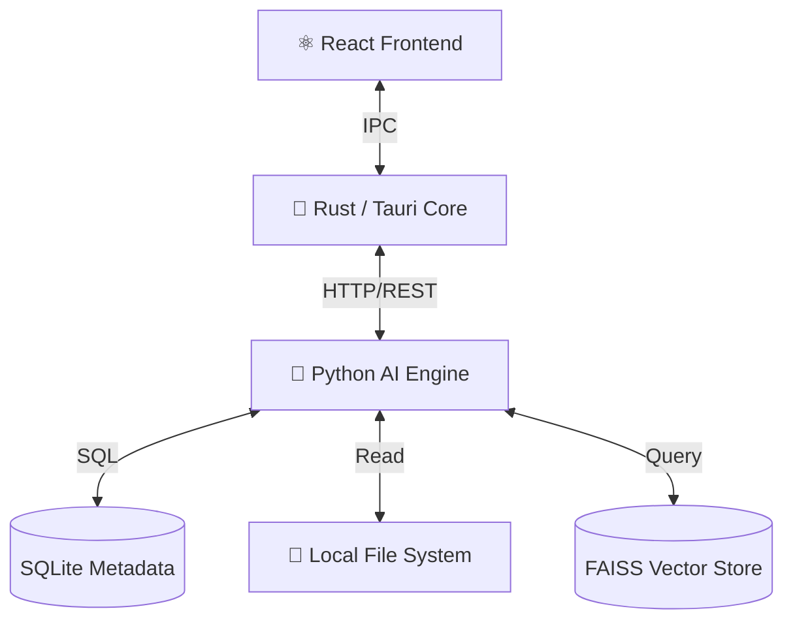

# LocalMind

<div align="center">


<!-- Replace with actual banner if available -->

<h3>Your Second Brain. Running Locally.</h3>


<p>
  <strong>LocalMind</strong> is a powerful, privacy-focused AI assistant that lives on your filesystem. 
  It indexes your digital life—documents, code, and notes—allowing you to search and chat with your data 
  without a single byte ever leaving your machine.
</p>

</div>

---

## ⚡ Why LocalMind?

We believe your personal data should remain **personal**. Cloud-based AI is powerful, but it requires trust. LocalMind removes the need for trust by running the entire intelligence stack on your own hardware.

- **🔒 Privacy First**: Zero data egress. Your vectors, your embeddings, your chats—all stay local.
- **🚀 Blazing Fast**: No network latency. Search results are instant.
- **🧠 Semantic Intelligence**: Don't just search for keywords; search for *ideas* and *concepts*.

## 🏗️ Engineering & Architecture

LocalMind is engineered for performance and security, leveraging the best tools for each layer of the stack.

### 🛡️ The Core: Rust & Tauri
At the heart of LocalMind is **Rust**, chosen for its unparalleled memory safety and performance.
- **Ultralight Footprint**: Unlike Electron apps that eat RAM, our Rust-based backend ensures the app runs efficiently in the background.
- **Native Security**: Rust's strict compile-time checks prevent entire classes of memory safety bugs.
- **OS Integration**: Handles global shortcuts, system tray, and native file system events with the speed of compiled code.

### 🧠 The Brain: Python & FastAPI
The intelligence layer is powered by a dedicated Python sub-process managed by the Rust core.
- **FastAPI**: Exposes a high-performance local API for the frontend.
- **Vector Search**: Uses **FAISS** indexers and high-quality **Sentence Transformers** models to create semantic maps of your data.
- **Data Persistence**: Metadata is stored reliably in **SQLite**, while vector indices are managed on disk.

### 😎 The Face: React & TypeScript
The user interface is built with modern web technologies, delivering a sleek, responsive experience.
- **Vite**: For instant development feedback and optimized builds.
- **Interactive UI**: A rich text editor, real-time chat interface, and visualized search results.



## 🚀 Getting Started

### Prerequisites
Before you start, ensure you have the following installed:
*   **Rust**: `curl --proto '=https' --tlsv1.2 -sSf https://sh.rustup.rs | sh`
*   **Node.js**: `v18+`
*   **Python**: `3.10+`

### Installation Guide

#### 1. Clone the Repository
```bash
=======
git clone https://github.com/adamfutur/localmind.git
cd localmind
```

#### 2. Set Up the AI Engine (Backend)
```bash
# Create and activate virtual environment
python -m venv venv
# Windows: .\venv\Scripts\activate | Unix: source venv/bin/activate

# Install dependencies (Torch, Transformers, FastAPI)
pip install -r backend/requirements.txt
```

#### 3. Set Up the Desktop App (Frontend)
```bash
cd desktop
npm install
```

#### 4. Ignite 🚀
You can run the full system with a single command:

**Windows**:
```bash
.\scripts\start_localmind.bat
```

**Manual Start (Dev Mode)**:
1.  Start Backend: `python -m backend.app`
2.  Start Frontend: `cd desktop && npm run tauri dev`

## 🤝 Contributing

We welcome contributions! Whether it's optimizing Rust memory usage, improving Python vectorization algorithms, or polishing the UI.

1.  Fork the Project
2.  Create your Feature Branch (`git checkout -b feature/AmazingFeature`)
3.  Commit your Changes (`git commit -m 'Add some AmazingFeature'`)
4.  Push to the Branch (`git push origin feature/AmazingFeature`)
5.  Open a Pull Request

## 📄 License

Distributed under the MIT License. See `LICENSE` for more information.

---

<div align="center">
  <sub>Built with ❤️ by pure local compute.</sub>
</div>
